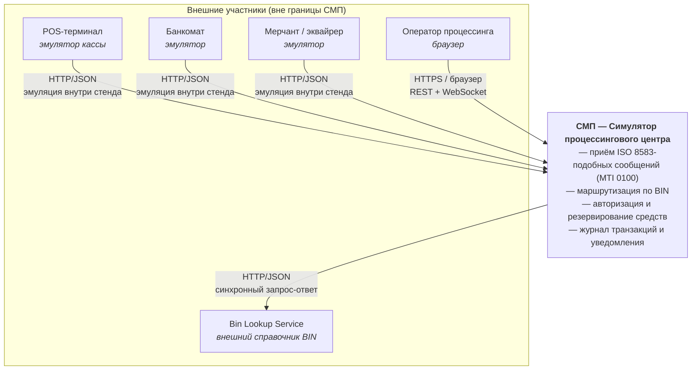

# А1. Карта системы - C4 Level 1 (Context)

Что было в проекте: ничего. architecture.md и
 architecture-diagram.puml — оба начинаются сразу с контейнеров, поэтому
непонятно, где вообще проходит граница СМП и кто её дёргает снаружи.

Что сделано: выделена граница СМП и пять внешних участников; для каждого указан
протокол входа.

## Диаграмма

## Что именно возвращается наружу

| Участник | Что отправляет | Что получает |
|---|---|---|
| POS / ATM / мерчант | `POST /api/transactions` (MTI 0100) | `AuthorizationResponse`: `status`, `responseCode`, `declineReason`, `rrn`, `authCode` |
| Оператор | `GET /api/cards/**`, `GET /api/dashboard/**`, `GET /api/transactions/**` | JSON-выборки, статистику, графики |
| Оператор (команды) | `POST/PATCH/DELETE /api/cards/**` | JSON карты; событие карты уходит в `smp.card-events` |
| СМП → Bin Lookup | `GET /api/bin/{bin}` | `issuerId`, справочная информация по BIN |

## Проверка по коду

| Что проверялось | Где подтверждение |
|---|---|
| Единственная внешняя точка входа — Gateway | `services/gateway/src/main/resources/application.yml`, блок `spring.cloud.gateway.routes` |
| Терминал/мерчант/дашборд ходят через Gateway, а не в сервисы напрямую | `services/terminal-simulator/.../application.yml` (`GATEWAY_URL`), `services/merchant-acquirer/.../application.yaml` (`gateway.url`), `services/dashboard/vite.config.ts` (`proxy.target = http://localhost:8080`) |
| Публичный маршрут транзакций переписывается во внутренний | `application.yml`: `RewritePath=/api/transactions, /api/internal/route`; `services/switch/.../RouteController.java` — `@PostMapping("/route")` |
| Bin Lookup — внешняя система СМП (Authorization ходит к ней со стороны) | `services/authorization/.../application.yaml`: `url: ${BIN_LOOKUP_URL:http://bin-lookup:8080}`; `services/bin-lookup/.../BinLookupController.java` — `@RequestMapping("/api/bin")`, `@GetMapping("/{bin}")` |
| Коды ответа, которые видит внешний мир | `services/common/.../AuthorizationResponse.java`: `00` approve, `05` общий отказ, `14` карта не найдена, `51` недостаточно средств, `54` истёк срок, `61` превышен лимит, `96` сервис недоступен |
| Операторские команды по картам | `services/card-management/.../CardController.java` (`/api/cards`) |

## Замечание по границам (верификация показала расхождение)

POS/ATM и мерчант описаны в ТЗ как внешние акторы, но физически эмулируются
сервисами самого стенда (`terminal-simulator`, `merchant-acquirer`) — они поднимаются
в `docker-compose.yaml` вместе с СМП. На диаграмме они оставлены вне границы,
потому что с точки зрения тестируемой системы это внешние клиенты: их падение или
перезапуск не является отказом СМП. Это важно для выбора уровня E2E-тестов — см.
`../test-cases.md`.
