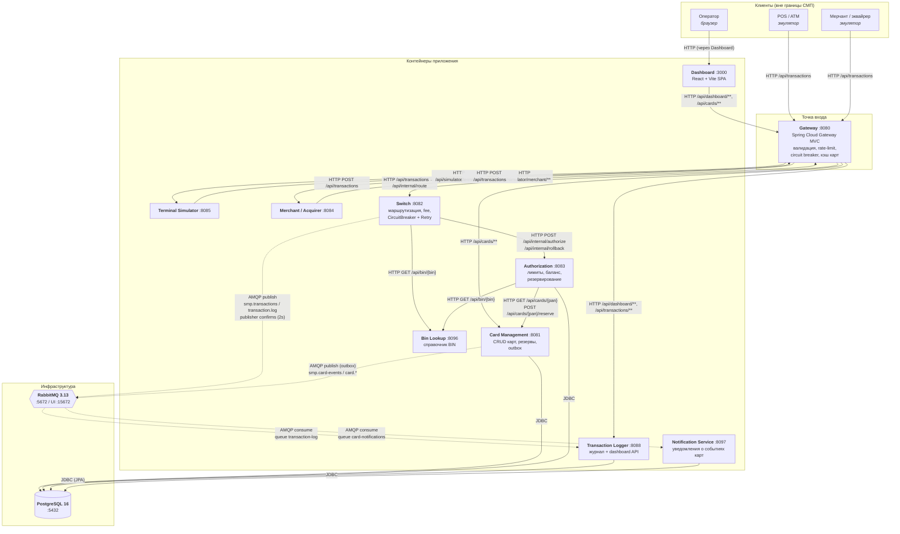

# А2. Карта системы — C4 Level 2 (Container)

Что было в проекте: диаграмма контейнеров есть дважды — `docs/architecture-diagram.puml`
и mermaid-блок в `docs/architecture.md`. Обе непригодны для планирования тестов:

- все связи нарисованы одинаковыми стрелками — sync и async из-за этого не различимы;
- `docs/architecture-diagram.puml` вообще не показывает RabbitMQ, outbox и publisher confirms;
- состав контейнеров не сверен с `docker-compose.yaml`.

Что сделано: пересобран состав контейнеров по `docker-compose.yaml` и по исходникам,
связи разведены на sync (сплошная линия, HTTP/JDBC) и async (пунктир, AMQP).

## Диаграмма

## Сверка состава с `docker-compose.yaml`

| Контейнер | Хост-порт | Где подтверждается |
|---|---|---|
| `gateway` | 8080 | `services/gateway/src/main/resources/application.yml` |
| `card-management` | 8081 | `services/card-management/.../application.properties` |
| `switch` | 8082 | `services/gateway/.../application.yml` (route URI) |
| `authorization` | 8083 | `services/switch` → `AuthorizationClient` |
| `merchant-acquirer` | 8084 | `services/merchant-acquirer/.../application.yaml` |
| `terminal-simulator` | 8085 | `services/terminal-simulator/.../application.yml` |
| `transaction-logger` | 8088 | `services/gateway/.../application.yml` (route URI) |
| `bin-lookup` | 8096 | `services/bin-lookup/.../application.yml`, health `/actuator/health` |
| `notification-service` | 8097 | `services/notification-service/.../application.yml`, health `/actuator/health` |
| `dashboard` | 3000 | `services/dashboard/vite.config.ts` (`proxy.target = :8080`) |
| `postgres` | 5432 | общий `datasource.url` во всех сервисах |
| `rabbitmq` | 5672 / 15672 | `services/*/.../RabbitMQConfig.java`, `application.yml` |

В ТЗ сказано «11 сервисов + PostgreSQL + RabbitMQ». По `docker-compose.yaml`
прикладных контейнеров 10: `gateway`, `card-management`, `switch`, `authorization`,
`bin-lookup`, `notification-service`, `transaction-logger`, `terminal-simulator`,
`merchant-acquirer`, `dashboard`. Плюс три контейнера observability-профиля
(`prometheus`, `grafana`, `loki`/`promtail`).

## Разметка sync / async

| Тип | Связи | Почему это важно для тестов |
|---|---|---|
| **sync (HTTP)** | Клиент→Gateway, Gateway→{Switch, CM, Logger, симуляторы}, Switch→Authorization, Switch→Bin Lookup, Authorization→{CM, Bin Lookup} | проверяются контрактом и проверкой кода ответа; отказ сразу виден клиенту |
| **sync (JDBC)** | CM, Authorization, Logger, Notification → PostgreSQL | требуют integration-уровня: реальная схема, транзакции, уникальные индексы |
| **async (AMQP)** | Switch→`smp.transactions`→Logger; CM(outbox)→`smp.card-events`→Notification | клиент **не увидит** ошибку доставки; нужны тесты на publisher confirm, DLQ и eventual consistency |

Ключевой вывод для пирамиды: у СМП есть асинхронная вилка внутри обработки
синхронного запроса (Switch публикует лог до возврата ответа). Именно она порождает
сценарий reversal — если подтверждения от брокера нет, одобренная транзакция
откатывается и клиент получает код `96`. См. `a4-sequences.md` и `a5-messaging.md`.

## Проверка по коду

| Утверждение | Подтверждение |
|---|---|
| Gateway — единственная внешняя точка | `services/gateway/.../application.yml`, `spring.cloud.gateway.routes` |
| Синхронные внутренние вызовы | `services/switch/.../AuthorizationClient.java`, `services/authorization/.../CardManagementClient.java`, `services/authorization/.../BinLookupClient.java` |
| Публикация транзакции в очередь | `services/switch/.../LoggerClient.java` → `rabbitTemplate` |
| Потребитель журнала | `services/transaction-logger/.../TransactionLogListener.java` (`@RabbitListener`) |
| Потребитель уведомлений | `services/notification-service/.../listener/CardEventListener.java` (`@RabbitListener`) |
| Публикация карт через outbox | `services/card-management/.../OutboxEventProcessorImpl.java` |
| Топология очередей | `services/switch/.../RabbitMQConfig.java`, `services/card-management/.../RabbitMQConfig.java` |
| Резервные пути Gateway | `TransactionValidationFilter`, `TransactionRateLimitFilter`, `ResponseCachingGatewayFilterFactory`, `CircuitBreakerFilter` |