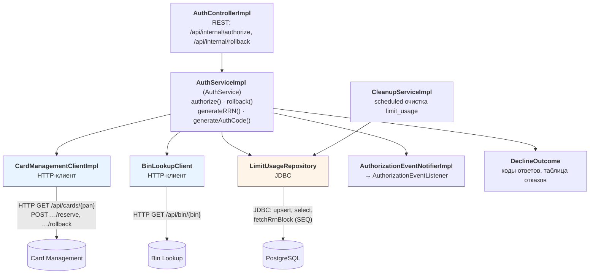
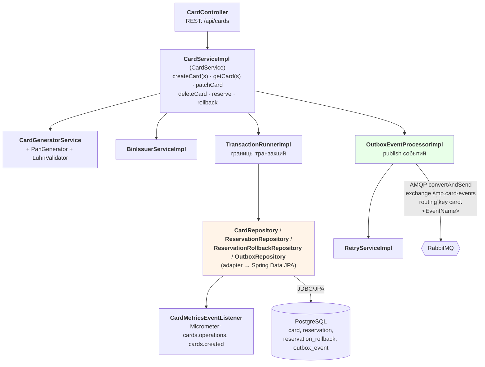

# А3. Карта системы — C4 Level 3 (Component)

Что было в проекте: ничего. `docs/architecture-diagram.puml` останавливается на
уровне контейнеров, поэтому не видно, где именно внутри сервиса живут HTTP-клиенты,
JDBC-доступ и публикация в RabbitMQ. Без этого нельзя выбрать уровень теста: непонятно,
что можно проверить на unit-уровне, а что требует поднятого окружения.

Что сделано: разобраны два самых нагруженных контейнера — Authorization и
Card Management.

---

## А3.1 Authorization Service

### Процесс `authorize()` — где принимается решение

Порядок проверок в `AuthServiceImpl.authorize()` (каждая ветка отказа = класс
эквивалентности и потенциальный тест-кейс):

| # | Проверка | Исход отказа | `responseCode` |
|---|---|---|---|
| 1 | `cardManagementClient.getCard(pan)` | `CARD_NOT_FOUND` | `14` |
| 1 | сервис CMS недоступен / 5xx | `SERVICE_UNAVAILABLE` | `96` |
| 1 | CMS ответил 402 (Payment Required) | `CARD_BLOCKED` | `05` |
| 2 | `card.status == ACTIVE` | `CARD_INACTIVE` / `CARD_BLOCKED` | `05` |
| 3 | `expiryDate` не в прошлом | `CARD_EXPIRED` | `54` |
| 4 | `amount ≤ availableBalance` | `INSUFFICIENT_FUNDS` | `51` |
| 5 | атомарный `upsertLimitUsage` (дневной и месячный лимит одной SQL-операцией) | `EXCEEDS_AMOUNT_LIMIT` | `61` |
| 5 | ошибка БД на лимитах | `DB_UNAVAILABLE` | `96` |
| 6 | `cardManagementClient.reserve()` | `RESERVATION_FAILED` / `INSUFFICIENT_FUNDS` | `96` / `51` |
| — | любое непойманное исключение | `UNKNOWN_REASON` | `05` |
| ok | все проверки пройдены | RRN (12 цифр) + authCode (6 символов) | `00` |

Порядок важен: баланс проверяется раньше лимитов, а дневной и месячный лимиты
проверяются одной операцией `upsertLimitUsage` (возврат `0` = превышение), а не двумя
независимыми ветками. Дублирующий `DuplicateKeyException`/`ConstraintViolationException`
обрабатывается повторным вызовом; повторная неудача → `DB_UNAVAILABLE` (`96`).

Проверка BIN (`binLookupClient.getIssuerId`) — не блокирующая: при недоступности
Bin Lookup сервис продолжает работу (graceful degradation), `issuerId` не обогащается.

### Процесс `rollback()`

`cardManagementClient.rollback(request)` → отображение исключений CMS в исходы:
`CardNotFoundException`/`InvalidRollbackRequestException` → `TRANSACTION_NOT_FOUND` (`14`),
`ServiceUnavailable`/`ResourceAccess`/`InternalCardManager` → `SERVICE_UNAVAILABLE` (`96`),
`RollbackConflictException` → `ALREADY_ROLLED_BACK` (`05`), `RollbackFailureException` →
`ROLLBACK_FAILED` (`96`), прочее → `UNKNOWN_REASON` (`05`).

---

## А3.2 Card Management Service

### Где живёт асинхронность (outbox)

`CardServiceImpl` не публикует в RabbitMQ напрямую. Он пишет событие в таблицу
`outbox_event` внутри той же транзакции, что и изменение карты. Дальше
`OutboxEventProcessorImpl.processSingleEvent` забирает событие и вызывает
`rabbitTemplate.convertAndSend(CARD_EVENTS_EXCHANGE, "card." + event.getClass().getSimpleName(), event)`.
При ошибке срабатывает `handleFail` → `RetryServiceImpl` (до `maxRetryCount` попыток),
после чего событие помечается как `failed()`.

Тестовое следствие: успешное создание карты (`HTTP 201`) гарантирует запись в
`outbox_event`, но не гарантирует доставку в Notification Service. Это два разных
проверяемых факта: первый — `api`/`integration`, второй — `e2e` с ожиданием
событийной согласованности.

---

## Проверка по коду

| Компонент | Файл |
|---|---|
| REST-контроллер авторизации | `services/authorization/.../controller/AuthControllerImpl.java` |
| Логика авторизации и отката | `services/authorization/.../services/AuthServiceImpl.java` |
| Таблица исходов и кодов | `services/authorization/.../constants/DeclineOutcome.java` |
| HTTP-клиент CMS | `services/authorization/.../client/CardManagementClientImpl.java` |
| HTTP-клиент Bin Lookup | `services/authorization/.../client/BinLookupClient.java` |
| Доступ к лимитам (JDBC) | `services/authorization/.../repositories/LimitUsageRepository.java` |
| События авторизации | `services/authorization/.../listeners/AuthorizationEventListener.java`, `AuthorizationLogEventListenerImpl.java` |
| REST-контроллер карт | `services/card-management/.../controller/CardController.java` |
| Логика карт, резервов | `services/card-management/.../services/CardServiceImpl.java` |
| Публикация outbox | `services/card-management/.../services/OutboxEventProcessorImpl.java` |
| Повторы публикации | `services/card-management/.../services/retries/RetryServiceImpl.java` |
| Репозитории | `services/card-management/.../repositories/*Repository*.java` |
| Метрики | `services/card-management/.../metrics/CardMetricsEventListener.java` |
