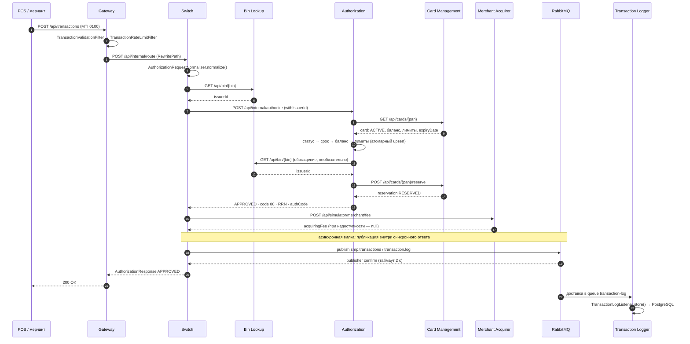
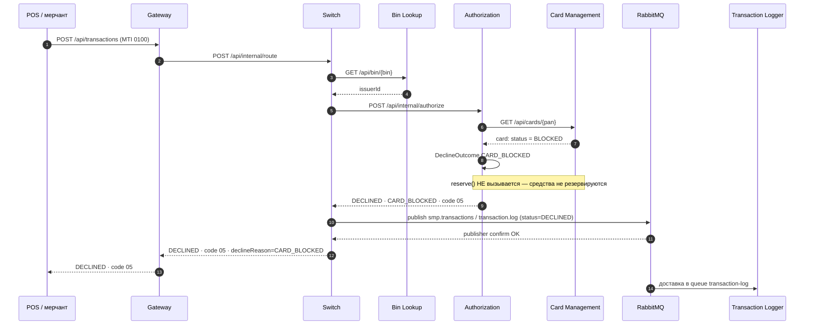
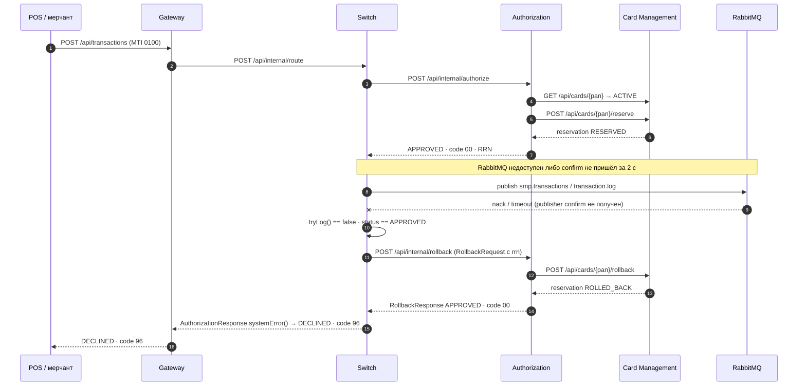

# А4. Карта системы — Sequence (последовательности)

Что было в проекте: в `docs/architecture.md` есть только happy path. Сценарии отказа
и отката не описаны, а именно они дают половину дефектов.

Что сделано: три сценария — happy path, declined и reversal. На каждом отмечено,
где вызов синхронный, а где начинается асинхронная вилка (публикация в RabbitMQ
внутри обработки синхронного запроса).

---

## А4.1 Happy path — операция одобрена (code `00`)

Что важно для тестов. Ответ клиенту возвращается после получения publisher confirm.
Если брокер не подтвердил публикацию за 2 с — клиент получит не `00`, а отказ (см. А4.3).
Доставка транзакции в Logger (`TransactionLogListener`) происходит уже после ответа
клиенту — это отдельный, eventually-consistent факт: его нельзя проверить в том же
запросе, только с ожиданием (Awaitility в e2e-тестах `RabbitMQAsyncE2eTest`).

---

## А4.2 Declined — карта заблокирована (code `05`)

Что важно для тестов. Отказ фиксируется в журнале так же, как одобрение — аналитика
по отказам должна строиться на тех же данных. Но: откат выполняется только для
APPROVED. Если публикация declined-транзакции не подтверждена, клиент всё равно получает
код отказа, а резерва не существует — значит откатывать нечего, и запись в журнал
теряется молча. Это отдельный проверяемый риск (см. ТК `TC-P3-A-05`).

---

## А4.3 Reversal — нет publisher confirm после APPROVED (code `96`)

Что важно для тестов.

- Reversal инициирует Switch, а не клиент: это компенсирующая операция внутри
  обработки оплаты, а не отдельное сообщение от терминала.
- В коде есть конструктор reversal-сообщения MTI `0400` —
  `AuthorizationRequest.forReversal(rrn)` (`services/common/.../AuthorizationRequest.java`).
  Фактический откат в текущей реализации идёт через `/api/internal/rollback`
  (`RollbackRequest`); хелпер `forReversal` в потоке reversal не вызывается. Это
  расхождение между «идеей» reversal и реализацией стоит уточнить у преподавателя
  (ОВ: какой из двух контрактов считается эталонным).
- Сценарий полностью негативный по побочным эффектам: успешный резерв в CMS должен
  быть скомпенсирован; проверяется возврат средств на баланс и `ReservationStatus.ROLLED_BACK`.
- Клиент при этом видит код `96`, а не `51`/`05` — важно не путать бизнес-отказ с отказом
  инфраструктуры.

---

## Разметка sync / async по шагам

| Шаг | Сценарий | Тип |
|---|---|---|
| Клиент → Gateway → Switch | все | sync HTTP |
| Switch → Bin Lookup | 1, 2 | sync HTTP |
| Switch → Authorization | все | sync HTTP (+ CircuitBreaker, Retry) |
| Authorization → Card Management | все | sync HTTP (+ graceful degradation на Bin Lookup) |
| Authorization → Bin Lookup | 1 | sync HTTP, не блокирующий |
| Switch → Merchant Acquirer (fee) | 1 | sync HTTP, не блокирующий (`null` при отказе) |
| Switch → RabbitMQ (`smp.transactions`) | все | async + publisher confirm 2 c |
| RabbitMQ → Transaction Logger | 1, 2 | async |
| Authorization → Card Management (`/rollback`) | 3 | sync HTTP (компенсация) |
| Card Management → RabbitMQ (`smp.card-events`, outbox) | события карт | async (см. А5) |

## Проверка по коду

| Утверждение | Файл |
|---|---|
| Порядок обработки запроса и решение об откате | `services/switch/.../service/RouteService.java` |
| Условие компенсации `!logged && APPROVED` | `services/switch/.../service/RouteService.java` |
| Публикация в очередь | `services/switch/.../service/LoggerClient.java` |
| CircuitBreaker + Retry на вызове Authorization | `services/switch/.../service/AuthorizationClient.java` |
| Комиссия не блокирует ответ | `services/switch/.../service/MerchantAcquirerClient.java` |
| Все ветки отказов и коды | `services/authorization/.../services/AuthServiceImpl.java`, `.../constants/DeclineOutcome.java` |
| Код `96` для system error | `services/common/.../AuthorizationResponse.java` (`systemError`) |
| MTI `0400` для reversal | `services/common/.../AuthorizationRequest.java` (`forReversal`) |
| Зарезервировать / откатить | `services/card-management/.../controllers/CardController.java` (`/{pan}/reserve`, `/{pan}/rollback`) |
| Потребитель журнала | `services/transaction-logger/.../TransactionLogListener.java` |
