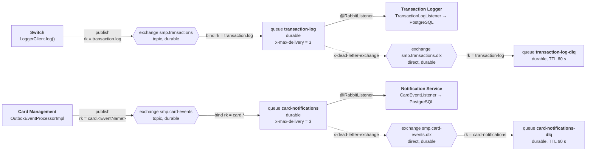

# А5. Карта системы — топология RabbitMQ

Что было в проекте: описано только текстом и таблицей в
`docs/architecture.md` («Асинхронное взаимодействие» + таблица «Exchange → Queue →
Routing key»), картинки нет. Направление DLX→DLQ, retry и publisher confirms в таблице
не видны, из-за чего риск «сообщение ушло в никуда» не читается.

Что сделано: топология визуализирована вместе с DLX/DLQ и привязками, сверена с
`RabbitMQConfig.java` обоих сервисов.

## Диаграмма

## Объекты топологии

| # | Exchange | Тип | Queue | Routing key | Producer | Consumer |
|---|---|---|---|---|---|---|
| 1 | `smp.transactions` | topic | `transaction-log` | `transaction.log` | Switch | Transaction Logger |
| 2 | `smp.transactions.dlx` | direct | `transaction-log-dlq` | `transaction-log` | (DLX) | — |
| 3 | `smp.card-events` | topic | `card-notifications` | `card.*` | Card Management (outbox) | Notification Service |
| 4 | `smp.card-events.dlx` | direct | `card-notifications-dlq` | `card-notifications` | (DLX) | — |

Аргументы очередей (одинаковые для обеих основных очередей):

| Аргумент | Значение | Смысл |
|---|---|---|
| `x-dead-letter-exchange` | `smp.<...>.dlx` | куда уходит «отравленное» сообщение |
| `x-dead-letter-routing-key` | `transaction-log` / `card-notifications` | ключ привязки DLX→DLQ |
| `x-max-delivery` | `3` | заявленный лимит повторных доставок |

Дополнительно:

| Настройка | Значение | Где |
|---|---|---|
| Publisher confirms | `publisher-confirm-type: correlated`, `publisher-returns: true` | `services/switch/.../application.yml` |
| TTL сообщений DLQ | 60 000 мс | оба `RabbitMQConfig.java` (`QueueBuilder…ttl(60_000)`) |
| Повторы публикации из outbox | 3 попытки с backoff, затем статус `FAILED` | `OutboxEventProcessorImpl.handleFail` + `RetryServiceImpl` |
| Retry HTTP-вызовов Switch | 3 попытки, backoff 1000/2000/4000 мс | `services/switch/.../application.yml` (`switch.retry`) |
| Circuit breaker на Authorization | failure-rate 50 %, окно 10, минимум 5 вызовов, размыкание 30 с | `services/switch/.../application.yml` |
| Management UI | `localhost:15672`, `smp` / `smp` | `docker-compose.yaml` |

## Верификация кодом выявила расхождения с документацией

Это важнее самой картинки — именно расхождения дают материал для тестов:

1. «Таймаут подтверждения 2 секунды» и `ConfirmCallback` в коде отсутствуют.
   `docs/architecture.md` утверждает: «Если брокер не подтверждает публикацию за
   2 секунды…» и «`ConfirmCallback.isAck() == false`». В коде нет ни `ConfirmCallback`,
   ни `CorrelationData`, ни `waitForConfirms`; `LoggerClient.log()` вызывает
   `rabbitTemplate.convertAndSend(...)` без ожидания и реагирует только на
   `AmqpException`. Число «2 с» соответствует HTTP-настройке
   `switch.http.logger-read-timeout-ms: 2000`, а не таймауту подтверждения.
   Следствие: сценарий reversal реально срабатывает при недоступности брокера,
   а не при медленном подтверждении. Формулировка теста должна это учитывать.

2. Аргумент `x-max-delivery` — нестандартный. В RabbitMQ лимит повторных доставок
   задаётся аргументом `x-delivery-limit` (и только для quorum-очередей). Очереди в
   конфигурации объявлены как обычные durable. Нужно проверить фактическое значение
   лимита и наличие `spring.rabbitmq.listener.simple.retry` — в `application.yml`
   он не задан. Пока это открытый вопрос: реальный предел повторных попыток
   на стороне потребителя может быть неограниченным.

3. Существующий e2e-тест reversal-пути ненадёжен.
   `RabbitMQAsyncE2eTest.testRollbackOnQueueUnavailable` (TC-23) не может остановить
   RabbitMQ программно, поэтому «обрабатывает оба случая» — при работающем брокере
   тест не проверяет откат вообще, а лишь фиксирует успешный сценарий. Проверка
   reversal требует управляемого отключения брокера (например, `docker stop` в
   отдельном шаге или прокси-заглушка вместо `smp-rabbitmq`).

## Проверка по коду

| Утверждение | Файл |
|---|---|
| Топология транзакций | `services/switch/.../config/RabbitMQConfig.java` |
| Топология карточных событий | `services/card-management/.../config/RabbitMQConfig.java` |
| Повторно объявленная топология у потребителей | `services/notification-service/.../config/RabbitMQConfig.java` |
| Публикация транзакций | `services/switch/.../service/LoggerClient.java` |
| Потребление транзакций | `services/transaction-logger/.../listener/TransactionLogListener.java` |
| Публикация карточных событий | `services/card-management/.../services/OutboxEventProcessorImpl.java` |
| Потребление карточных событий | `services/notification-service/.../listener/CardEventListener.java` |
| Настройки confirms/retry | `services/switch/.../application.yml` |
| Заявления документации для сравнения | `docs/architecture.md`, разделы «Асинхронное взаимодействие» и «Publisher Confirms» |
| Существующий e2e-тест | `services/e2e-tests/.../RabbitMQAsyncE2eTest.java` |
