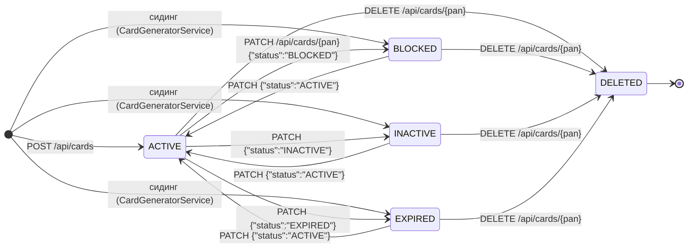
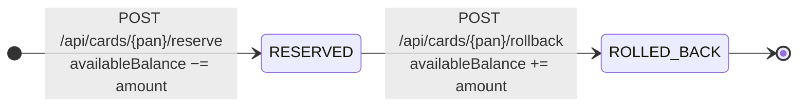
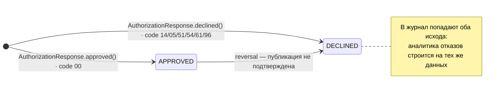

# А6. Карта системы — State-transition

Что было в проекте: ничего. Состояния карты упоминаются в ТЗ и в `docs/api-spec.md`
списком, но переходов нет — а именно переходы дают тесты «что нельзя сделать»:
нельзя зарезервировать средства по неактивной карте, нельзя удалить карту дважды,
нельзя дважды откатить один резерв.

Что сделано: три диаграммы состояний (статус карты, резерв, транзакция в журнале)
и разбор расхождений между ТЗ и кодом.

---

## А6.1 Состояния карты (`Card.status`, Card Management)

Правила, вычитанные из кода:

| Правило | Что происходит | Подтверждение |
|---|---|---|
| `PATCH` может поставить любой статус | переходы между ACTIVE/INACTIVE/BLOCKED/EXPIRED свободны, не матричные | `Card.patched()` / `CardController.patchCard` |
| `DELETE` — мягкое удаление | статус → `DELETED`, запись остаётся в БД | `Card.deleted()` |
| Повторный `DELETE` | `IllegalStateException("Card already deleted")` → клиенту `404` | `Card.deleted()` (строка 169) |
| `DELETED` — терминальное | переходов из него нет | `Card.deleted()` + `GET /api/cards/{pan}` → `404` для DELETED |
| Операции требуют `ACTIVE` | иначе `IllegalStateException` «Can't perform operation…» | `Card.checkStatusOrThrow()` (вызывается из `startReservation`) |
| Массовое изменение | `POST /api/cards/bulk-update` меняет статус пачке карт | `CardController.bulkUpdateStatus` |

## А6.2 Жизненный цикл резерва (`ReservationStatus`)

| Правило | Подтверждение |
|---|---|
| Уникальность резерва по RRN | `reservationRepository.isUnique` → `ReservationAlreadyExistsException` |
| Повторный откат → конфликт | `Reservation.rolledBack()` → `RollbackConflictException` → `ALREADY_ROLLED_BACK` (`05`) |
| Откат возвращает сумму на баланс | `Card.withRollback()` — `availableBalance.add(...)` |
| Резерв требует статуса ACTIVE | `Card.startReservation()` → `checkStatusOrThrow()` |

## А6.3 Жизненный цикл транзакции в журнале (`TransactionStatus`)

Переход `APPROVED → DECLINED` — это не смена статуса одной записи, а сценарий: при
недоступности RabbitMQ резерв откатывается (`ReservationStatus.ROLLED_BACK`), а клиент
вместо одобрения получает `responseCode 96`. Запись в журнал при этом **не появляется
вообще** — публикация и была тем, что сломалось.

---

## Расхождения ТЗ / кода, найденные при верификации

1. В ТЗ четыре статуса, в коде пять. ТЗ перечисляет
   ACTIVE/INACTIVE/BLOCKED/EXPIRED. В `CardStatus.java` есть ещё
   `DELETED` — мягкое удаление вместо физического.
2. Authorization не знает про `DELETED`. Свой enum `CardModelStatus` в
   `services/common/.../CardModelStatus.java` содержит только четыре значения.
   До Authorization удалённая карта не доходит: CMS отдаёт `404`, и авторизация
   заканчивается исходом `CARD_NOT_FOUND` (`14`).
3. В журнале нет статуса `ROLLED_BACK`. `TransactionStatus` содержит только
   `APPROVED` и `DECLINED`. Отменённая из-за сбоя публикации транзакция для
   наблюдателя снаружи выглядит как обычный отказ `96`, а факт отката резерва виден
   только в CMS (`ReservationStatus.ROLLED_BACK`). Разрыв в наблюдаемости —
   самый интересный дефект карты состояний: по журналу невозможно посчитать, сколько
   транзакций было отменено компенсацией.
4. Просрочка не автоматизирована. Нет планировщика, который переводит
   `ACTIVE → EXPIRED` по `expiryDate`. Статус `EXPIRED` выставляется вручную через
   `PATCH` или при сидинге, а фактическая просрочка проверяется отдельно —
   по `expiryDate` в `AuthServiceImpl` (последний день месяца). То есть карта может
   быть «просрочена по дате», но иметь статус `ACTIVE`; для теста это два разных
   способа получить код `54`, и оба надо проверять.

## Проверка по коду

| Утверждение | Файл |
|---|---|
| Список статусов карты (5 значений) | `services/card-management/.../models/CardStatus.java` |
| Правила переходов и запреты | `services/card-management/.../models/Card.java` (`deleted()`, `checkStatusOrThrow()`, `startReservation()`, `withReservation()`, `withRollback()`) |
| Статусы резерва | `services/card-management/.../models/ReservationStatus.java`, `Reservation.java` |
| Статусы транзакции в журнале | `services/common/.../dto/transactionlogger/TransactionStatus.java` |
| Статус, который видит Authorization | `services/common/.../dto/cardmanagement/CardModelStatus.java` |
| REST-операции над статусом | `services/card-management/.../controllers/CardController.java` (`/`, `/{pan}`, `/{pan}/reserve`, `/{pan}/rollback`, `/bulk-update`) |
| Проверка статуса и срока при авторизации | `services/authorization/.../services/AuthServiceImpl.java` |
